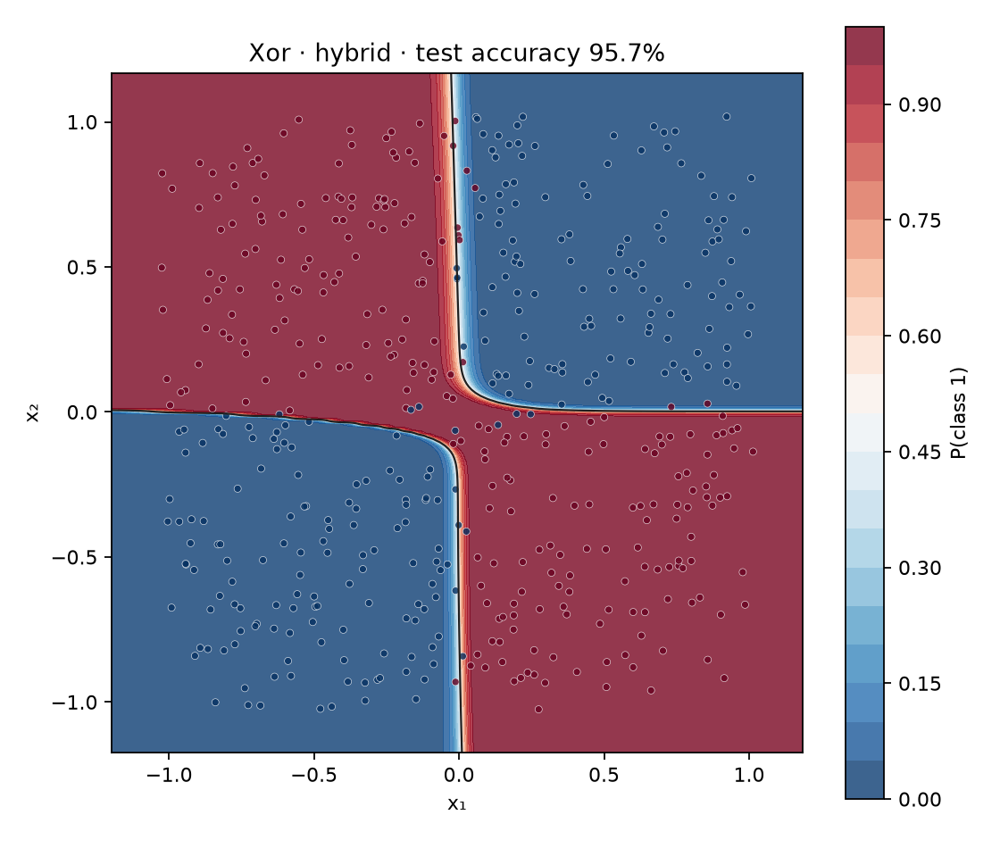

# Backprop NEAT with Increased Network Complexity

**An end-to-end JAX implementation combining NEAT topology evolution with inherited gradient-based weight optimization.** Networks begin with no hidden nodes and can acquire nodes and connections while learning XOR, Circle, and Spiral classification boundaries.

This repository implements a feedforward, Lamarckian NEAT variant from scratch. It includes historical innovation tracking, aligned crossover, persistent species, fitness sharing, stagnation handling, structural mutation, and batched JAX/Optax training. It is an educational research implementation, not an exact reproduction of the original NEAT experiments.

See the [executed examples](examples/README.md) for measured results, saved models, exact data, and generated plots. The XOR demonstration achieved **95.7% held-out accuracy** with six evolved hidden nodes, and Circle achieved **96.3%** with five (seed 42; task-specific budgets). These are demonstrations, not multi-seed evidence of superiority.



## Install

Python 3.11+ is required. A CPU works; accelerated hardware is optional.

```bash
git clone https://github.com/rohitsalla/backprop-neat-jax.git
cd backprop-neat-jax
python -m venv .venv
source .venv/bin/activate
python -m pip install -e '.[dev]'
```

For GPU support, install the appropriate JAX build using the [official installation guide](https://docs.jax.dev/en/latest/installation.html). The default pip installation uses CPU JAX. Exact versions used for the checked-in demonstration are recorded in `examples/results/*/environment.json` and `requirements-lock.txt`.

## Run experiments

```bash
# Default hybrid experiment: 32 genomes, 40 generations, 80 Adam steps/generation.
backprop-neat train --task xor --output runs/xor

# Task-specific, larger experiments.
backprop-neat train --config configs/circle.json --output runs/circle
backprop-neat train --config configs/spiral.json --output runs/spiral

# Quick pipeline check.
backprop-neat train --config configs/smoke.json --output runs/smoke

# Multi-seed comparison: all three tasks and all three methods.
backprop-neat benchmark --seeds 0 1 2 --output runs/comparison

# Smaller comparison or a targeted ablation.
backprop-neat benchmark --tasks xor circle --modes hybrid evolution \
  --seeds 0 1 --generations 15 --population-size 16 --output runs/ablation
```

Every `Config` field is available as a kebab-case CLI flag, and flags override JSON config values. Outputs must be empty directories to avoid overwriting earlier experiments. `python -m backprop_neat` works as an alternative to the executable.

Each run writes:

| Artifact | Contents |
| --- | --- |
| `config.json` | Full experiment configuration and seed |
| `environment.json` | Python/package versions, platform, JAX devices |
| `champion.json` | Human-readable node/connection genes and trained weights |
| `metrics.json` | Final train, validation, test metrics; selected generation; complexity; runtime |
| `history.csv` | Generation accuracy/loss, species counts, node and connection growth |
| `dataset.npz` | Exact train, validation, and test arrays |
| `decision_boundary.png` | Probability contours with held-out test samples |
| `learning_curves.png` | Accuracy, loss, architectural growth, and diversity |
| `topology.png` | Selected directed graph with signed connection weights |

Benchmarks additionally write per-run `results.csv` and a `summary.json` with mean test accuracy and sample standard deviation across seeds. The CSV is updated after each completed run.

## How learning works

1. Initialize a population with two inputs, one output, two connections, and zero hidden nodes.
2. Pack each variable graph into a masked, topologically ordered array of capacity `max_nodes`.
3. Train enabled weights and non-input biases on training data using full-batch Adam, `jax.value_and_grad`, `vmap`, and `lax.scan`.
4. Write the trained parameters back into the genome. Offspring inherit these optimized values (Lamarckian inheritance).
5. Evaluate validation cross entropy and subtract a small connection complexity cost to obtain fitness.
6. Assign genomes to persistent species using excess, disjoint, and matching-weight distances.
7. Allocate offspring with fitness sharing, preserve elites, cross aligned genes, perturb parameters, and add nodes/connections.
8. Repeat, select the best penalized validation fitness across generations, then evaluate that saved champion on the test set once.

Hidden nodes use `tanh`; the output is a logit trained with numerically stable binary cross entropy. Inserting a `tanh` node changes the represented function; the split mutation is **not** exactly function-preserving. Adam moments reset each generation, while learned weights and biases persist.

### Structural mutations and historical identity

An add-node mutation disables an enabled edge and replaces it with two edges through a hidden node. The source-to-hidden weight starts at 1 and the hidden-to-target weight inherits the old edge weight. Add-connection mutation adds a valid absent edge or re-enables a disabled edge.

The shared innovation tracker assigns the same connection ID to the same endpoint pair and the same hidden-node ID to repeated splits of a historical edge. This registry persists for the complete run. Immutable node depths constrain every edge to point from lower to higher depth; consequently crossover cannot introduce cycles. Hidden nodes at equal depth cannot connect directly.

Crossover samples matching genes from either parent and takes excess/disjoint genes from the fitter parent. On equal fitness, one parent is chosen randomly as primary rather than taking the union. A matching gene disabled in either parent is disabled in the child with probability 0.75. Biases of matching nodes are inherited independently.

### Species and selection

Compatibility is `c_excess * E/N + c_disjoint * D/N + c_weight * mean_abs_weight_difference`. As in common NEAT implementations, `N=1` for genomes with fewer than 20 connection genes. Species retain representatives and best-fitness histories across generations; stagnant species stop receiving offspring, except the species containing the current global population champion.

Fitness is `-validation_BCE - complexity_penalty * enabled_connections`. Reproduction applies a shared exponential fitness transform, averages it within each species, and allocates integer offspring counts with the largest-remainder method. Survivors are the top fraction of each species. One global elite always survives; species with at least two allocated slots also preserve their own elite. The population size remains exact.

## Datasets and evaluation

All datasets are generated locally; no downloads are required. Train, validation, and test samples use independent seeded NumPy random streams. No normalization is fitted on validation or test data.

| Task | Definition |
| --- | --- |
| XOR | Uniform points in `[-1,1]^2`; label 1 when the coordinate signs differ |
| Circle | Uniform points in `[-1,1]^2`; label 1 inside radius `sqrt(2/pi)`, giving equal expected class areas |
| Spiral | Two interleaved spiral arms; `angle = 3*pi*radius + pi*label`, radius drawn area-uniformly |

Gaussian coordinate noise is added after generating labels. Points near boundaries may therefore be ambiguous. XOR here is a sampled 2D classification problem, not just the four-point truth table; gradient correctness is also tested on the exact truth table.

Training uses only training labels. Validation drives repeated model selection, so it is not an unbiased final score. Test data never enters gradients, species assignment, reproduction, or champion selection. Its final metrics and scatter plot are generated after selection. For stronger claims, use multiple seeds and independent held-out evaluation runs.

## Baselines and interpretation

| Mode | Topology | Weight optimization |
| --- | --- | --- |
| `hybrid` | Starts minimal, mutates | Adam + evolutionary perturbation |
| `evolution` | Starts minimal, mutates | Evolutionary perturbation only |
| `fixed` | One hidden layer (`fixed_hidden=12`) | Adam + evolutionary perturbation |

The fixed baseline uses the same population, validation selection, and evolutionary weight operations, with a fixed graph. It is a population-based control for topology growth, not a conventional single-model MLP baseline. Matching generations and population size does **not** match compute across methods or graph sizes. Runtime is recorded to make this limitation visible. Single-seed demonstrations establish that the pipeline runs; they do not establish superiority over either baseline.

## Use a trained model

```python
import json
import numpy as np
from backprop_neat.genome import Genome
from backprop_neat.network import predict

with open("runs/xor/champion.json") as f:
    model = Genome.from_dict(json.load(f))
x = np.array([[-1, -1], [-1, 1], [1, -1], [1, 1]], dtype=np.float32)
print(predict(model, x))
```

Or supply a CSV with the header `x1,x2`:

```bash
backprop-neat predict --model runs/xor/champion.json \
  --input examples/points.csv --output runs/predictions.csv
```

## Development

```bash
pytest -q
ruff check .
ruff format --check .
```

CI runs the test suite on Python 3.11 and 3.12. Tests cover innovation identity, mutation/crossover invariants, masks and gradients, NumPy/JAX forward agreement, parameter inheritance, deterministic data and evolution, fixed/evolution controls, saved-model inference, and experiment artifacts. See [the algorithm notes](docs/ALGORITHM.md) for mathematical and implementation details.

## Project layout

```text
src/backprop_neat/
  config.py       Validated experiment settings
  data.py         Seeded XOR, Circle, and Spiral generators
  genome.py       Genes, innovation history, mutation, crossover, distance
  network.py      Masked JAX graphs, vectorized Adam, inference
  evolution.py    Persistent species, fitness sharing, reproduction
  experiment.py   Training loop, selection, serialization
  plots.py        Boundaries, curves, network diagrams
  cli.py          Training, benchmarking, prediction commands
configs/          Reusable experiment configurations
tests/            Unit and integration tests
examples/         Executed demonstrations and inference inputs
```

## Scope and references

This implementation supports two-input binary classifiers and feedforward DAGs. It does not implement recurrent NEAT, deletion mutations, distributed execution, optimizer-state inheritance, or resumable full-population checkpoints. `champion.json` is an inference checkpoint, not a complete evolution checkpoint. Dense padded graph storage costs `O(population_size * max_nodes^2)`; the capacity bounds growth and memory without choosing the actual topology. JAX can recompile when batch shapes or static training settings change.

- Stanley & Miikkulainen (2002), [Evolving Neural Networks through Augmenting Topologies](https://nn.cs.utexas.edu/downloads/papers/stanley.ec02.pdf).
- [JAX transformations: differentiation and vectorization](https://docs.jax.dev/en/latest/101/transformations.html).
- [JAX structured control flow](https://docs.jax.dev/en/latest/control-flow.html).
- [Optax documentation](https://optax.readthedocs.io/en/latest/).

MIT licensed.
