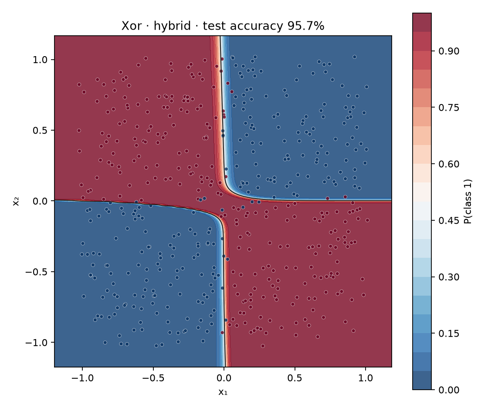
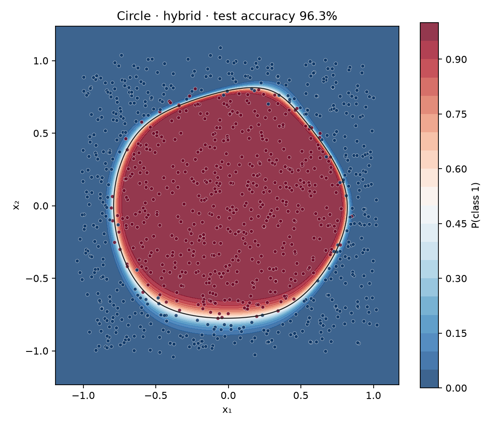

# Executed demonstrations

These are single-seed hybrid runs (seed 42), using the task-specific configs in
`configs/`. Models are selected by penalized validation cross entropy. Test
accuracy is evaluated only after selection. These runs demonstrate the pipeline;
they do not establish a method ranking or statistical significance.

| Task | Train accuracy | Validation accuracy | Test accuracy | Hidden nodes | Enabled edges |
| --- | --- | --- | --- | --- | --- |
| XOR | 98.4% | 99.2% | 95.7% | 6 | 13 |
| Circle | 96.7% | 98.4% | 96.3% | 5 | 17 |

Each result directory contains the exact settings, data splits, selected model,
metrics, package versions, history, and three generated figures. Different tasks
use different budgets; see each `config.json` before comparing scores or runtime.
All networks in these runs began with zero hidden nodes and two edges.

Reproduce in new output directories:

```bash
backprop-neat train --config configs/xor.json --output runs/reproduce-xor
backprop-neat train --config configs/circle.json --output runs/reproduce-circle
backprop-neat train --config configs/spiral.json --output runs/reproduce-spiral
```

CPU runtime depends strongly on capacity, population, and sample count. The
larger Spiral configuration is intended as a longer experiment; use
`--generations 10 --population-size 12 --train-steps 20` for a quick trial.

The predictions below are available through `backprop-neat predict`; `points.csv`
contains the four exact XOR truth-table inputs. Output probabilities, rather than
only hard labels, make uncertainty visible.

## XOR



[Learning curves](results/xor/learning_curves.png) · [Topology](results/xor/topology.png) · [Metrics](results/xor/metrics.json)

## Circle



[Learning curves](results/circle/learning_curves.png) · [Topology](results/circle/topology.png) · [Metrics](results/circle/metrics.json)
